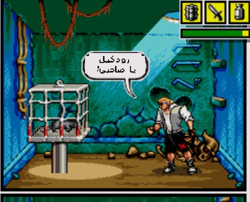
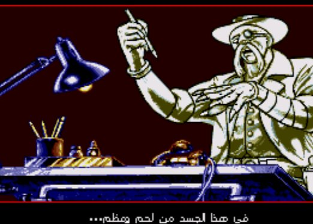
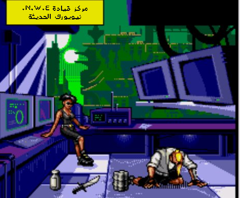
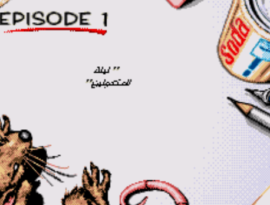

# Comix Zone — Arabic Localization & Assembly Enhancements

تعريب متكامل وهندسة عكسية للعبة **Comix Zone** لجهاز **Sega Genesis / Mega Drive**، متضمناً خط بكسل عربي عالي الدقة، نظام حفظ تقدم اللعبة (SRAM Auto-Save)، وتعديلات تجميعية دقيقة لمعالج Motorola 68000 لتحسين توازن اللعبة وسلاسة التجربة.

Comprehensive Arabic fan translation, custom Rooyin pixel font pipeline, SRAM auto-save integration, and Motorola 68000 assembly enhancements for *Comix Zone* (Sega Genesis / Mega Drive).

---

## 📸 معاينات حية من داخل اللعبة / Live In-Game Screenshots

| فقاعات الحوار (Dialogue Bubble) | المشاهد السينمائية السردية (Story Cutscenes) |
|:---:|:---:|
| <br><sub>**حوار داخل اللعبة:** سكيتش تيرنر يتحدث مع رودكيل داخل القفص ("رودكيل، يا صاحبي!")</sub> | <br><sub>**المشهد الافتتاحي:** مورتس يرسم في مرسمه ("في هذا الجسد من لحم وعظم...")</sub> |

| الصناديق السردية الصفراء (Narrative Box) | بطاقة بداية الحلقة (Episode Title Card) |
|:---:|:---:|
| <br><sub>**الصناديق السردية:** أليسا وسكيتش في غرفة القيادة ("مركز قيادة N.W.E. / نيويورك الحديثة")</sub> | <br><sub>**شاشة البداية:** الحلقة الأولى ("ليلة المتحولين") بالخط العربي</sub> |

---

## 🌟 مميزات المشروع / Project Highlights

1. **التعريب الكامل والخط العربي المتصل (Arabic Typography & Dialogue):**
   - ترجمة شاملة لجميع نصوص اللعبة (876 سطراً تشمل فقاعات الحوار، العناوين، الصناديق الصفراء، ونصوص المشاهد).
   - بناء خط عربي عالي الدقة (8px) مشتق من خط Rooyin متوافق مع محرك الخط المتغير (VWF - 4bpp).
   - باليت ألوان أصلية متطابقة مع أسلوب الكوميكس: خط أبيض للفقاعات (`0x0F`) وخط أصفر أصيل للصناديق (`0x0C`).
   - تشكيل تلقائي ودعم علامات الترقيم العربية (مثل ؟ المعكوسة).

2. **نظام الحفظ التلقائي (SRAM Auto-Save):**
   - دمج كود حفظ اللعبة التلقائي عند انتهاء كل مرحلة عبر بطارية الكارتريدج (SRAM).
   - إمكانية تحميل الحفظ مباشرة من قائمة الخيارات (`Options -> Load + C`).
   - توسيع مساحة الروم من 2 ميجابايت إلى 2.5 ميجابايت وتحديث ترويسة سيجا الرسمية عند `0x1A0`.

3. **تحسينات المعالج التجميعية (M68000 Assembly Enhancements):**
   - **إلغاء ضرر الارتداد عند تكسير المجسمات (`0x1D074A`):** تكسير الصناديق والبراميل والمراوح لا يخصم أي نقطة من صحة سكيتش تيرنر.
   - **تخفيض ضرر الأعداء بنسبة 50% (`0x1D0572`):** مضاعفة القدرة على الصمود في المعارك بأسلوب عادل.
   - **الشاي المثلج يشفي 100% (`0x1D3202`):** تعبئة شريط الطاقة بالكامل عند التقاط الشاي المثلج.
   - **حركة الطائرة الورقية مجانية (`0x1D0312`):** إلقاء الطائرة لا ينقص الصحة.
   - **سلامة إحداثيات الكاميرا والغرف بنسبة 100% (`0x1D48AA`):** الانتقال بين اللوحات والغرف يعمل بسلاسة دون أي تشوه بصري أو تجميد.

---

## 🎯 التحقق من الروم الأصلي وتطبيق الباتش / Patching Guide

الرقعة المرفقة متوفرة بصيغة **BPS (Beat Patch System)** وتحتوي حصراً على فروقات بايتات ثنائية دون أي ملفات محمية بحقوق النشر.

### 1. بيانات الروم الأصلي النظيف (USA Base ROM):
- **الملف:** `Comix Zone (USA).md` (أو `.bin` / `.gen`)
- **الحجم:** `2,097,152` بايت (2.0 MB)
- **SHA-1:** `E8747EEFDF61172BE9DA8787BA5BE447EC73180F`
- **CRC-32:** `17DA0354`

### 2. طريقة تطبيق الباتش:
1. استخدم أي برنامج باتش يدعم BPS مثل **Floating IPS (FLIPS)** أو **Rom Patcher JS** (في المتصفح).
2. اختر الروم الأصلي `Comix Zone (USA).md`.
3. طبّق الباتش: `patches/comix_zone_arabic_final.bps`.
4. سينتج الروم المعرب النهائي:
   - **الحجم:** `2,621,440` بايت (2.5 MB)
   - **SHA-1:** `6C09F46B96388C8F1E910C98E9D357FD58D966C4`
   - **CRC-32:** `49C96A02`

---

## 🛠️ هيكلية المستودع / Repository Layout

```text
comix-zone-arabic/
├── docs/                 # تقارير التسليم والملاحظات الفنية
├── encoding/             # كتالوج الترجمات النهائي (JSON) وجداول التشفير (.tbl)
├── font/                 # أصول خط Rooyin، خرائط الغليفات، وبنوك الخطوط الثنائية
├── patches/              # رقع BPS و IPS النهائية ورقعة SRAM
├── previews/             # لقطات المعاينة البصرية المباشرة
├── tools/                # أدوات البناء التلقائي، محول الخطوط، وحاقن النصوص
├── .gitignore
├── LICENSE               # ترخيص MIT للمشروع
├── README.md
└── requirements.txt      # متطلبات بيئة بايثون (Pillow)
```

---

## ⚡ البناء والتوليد البرمجي / Building from Source

إذا كنت تملك الروم الأصلي وترغب في إعادة بناء الروم المعرب بنفسك:

```bash
pip install -r requirements.txt
python tools/build_master_arabic_rom.py "path/to/Comix Zone (USA).md"
```

---

## ⚖️ إخلاء مسؤولية قانوني / Legal Disclaimer

هذا المشروع عبارة عن عمل تعريب غير تجاري ومفتوح المصدر موجّه لهواة ومجتمع ألعاب الريترو.
**المستودع لا يحتوي على أي ملفات ROM أو كود أصلي أو مواد صوتية وبصرية محمية بحقوق النشر.**
جميع الحقوق والعلامات التجارية للعبة *Comix Zone* مملوكة لشركة **SEGA Corporation**. لاستخدام الباتش يجب أن تمتلك نسختك القانونية الأصلية من اللعبة.

---

## 📜 الترخيص / License

جميع الأدوات البرمجية، السكربتات، وبنوك الخطوط المنشأة في هذا المستودع مرخصة تحت ترخيص **MIT License**.
خط Rooyin الأصلي يخضع لترخيص **SIL Open Font License 1.1**.
